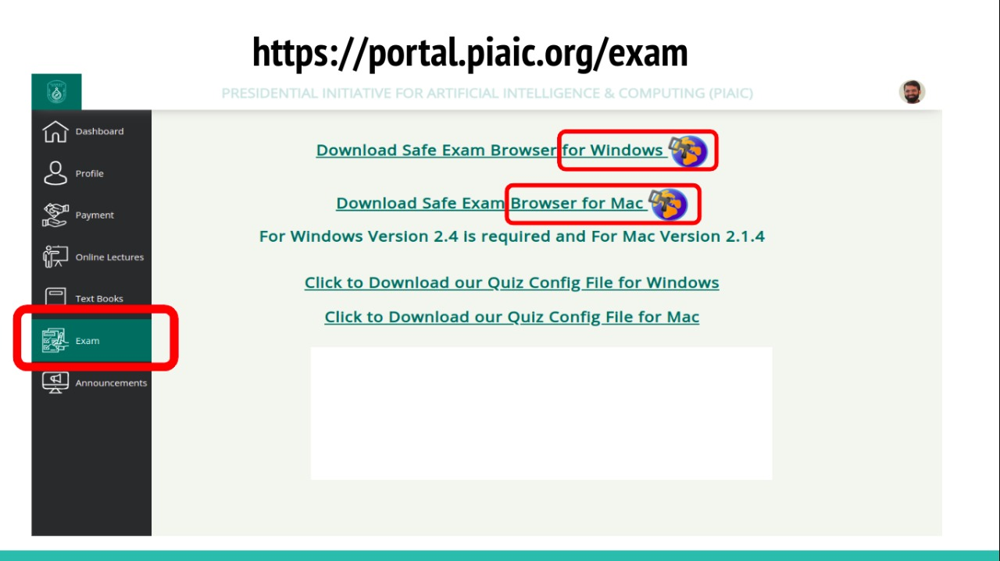
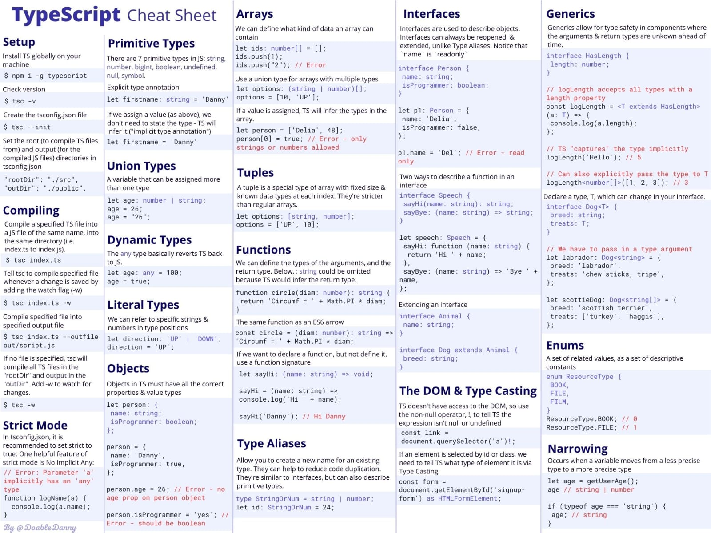

# 🚀 Learn TypeScript 5.0+ in Baby Steps

TypeScript is a statically typed superset of JavaScript that enhances development with type safety and modern features. This guide will walk you through TypeScript 5.0+ using a structured approach, incorporating official documentation, tutorials, and hands-on projects.

---

## 📘 Starting Point: Official Resources

### 📄 TypeScript 5.0 Documentation
The official TypeScript Handbook provides comprehensive coverage of all features introduced in TypeScript 5.0, including decorators, const type parameters, and performance optimizations.  
- **Link:** [TypeScript 5.0 Release Notes](https://www.typescriptlang.org/docs/handbook/release-notes/typescript-5-0.html)

### 🎓 TypeScript for the New Programmer
Ideal for beginners, this guide introduces TypeScript concepts from scratch, making it accessible even if you're new to programming.  
- **Link:** [TypeScript From Scratch](https://www.typescriptlang.org/docs/handbook/typescript-from-scratch.html)

---

## 🎥 Video Tutorials

### 🧑‍🏫 TypeScript 5 Tutorial for Beginners 2023
A step-by-step tutorial designed for beginners, covering TypeScript 5 features with practical examples.  
- **Link:** [YouTube Video](https://www.youtube.com/watch?v=2kBjtkrjeDM)

### 📘 TypeScript 5.0 Full Course
An all-in-one tutorial that delves deep into TypeScript 5.0, suitable for those who prefer a comprehensive learning experience.  
- **Link:** [YouTube Full Course](https://www.youtube.com/watch?pp=0gcJCfwAo7VqN5tD&v=gieEQFIfgYc)

---

## 🔧 Key Features in TypeScript 5.0

| Feature                     | Description                                                                 |
|-----------------------------|-----------------------------------------------------------------------------|
| **Modernized Decorators**   | Aligns with the ECMAScript proposal for decorators, enhancing metadata reflection and type safety. |
| **Const Type Parameters**   | Introduces `const` type parameters, enabling more precise type inference. |
| **Enum Improvements**       | Optimizes enum compilation, improving runtime performance and reducing bundle sizes. |
| **Performance Enhancements**| Significant improvements in speed, memory usage, and package size. |

For detailed notes:  
- [Official Release Notes](https://www.typescriptlang.org/docs/handbook/release-notes/typescript-5-0.html)  
- [Kinsta Article on TypeScript 5.0](https://kinsta.com/blog/typescript-5-0/)  
- [Dev.to Deep Dive](https://dev.to/info_generalhazedawn_a3d/exploring-the-latest-features-of-typescript-50-a-deep-dive-into-new-improvements-3ck9)

---

## 🧪 Hands-On Learning

### 💻 TypeScript Playground
Experiment with TypeScript code directly in your browser using the official TypeScript Playground.  
- **Link:** [TypeScript Playground](https://www.typescriptlang.org/play)

### 🧰 TypeScript Projects
Engage in practical projects to solidify your understanding of TypeScript concepts.  
- **Link:** [TypeScript Project Examples](https://github.com/LearningTypeScript/projects)

- **Node.js TypeScript Projects:** [GitHub Repository](https://github.com/panacloud-modern-global-apps/typescript-node-projects)

---

## 🧙‍♂️ Learn from Experts

### Matt Pocock – TypeScript Wizard
Matt Pocock offers a series of tutorials and resources to deepen your TypeScript knowledge.

- **Website:** [Total TypeScript](https://www.totaltypescript.com/)  
- **Crash Course for Beginners (Video):** [YouTube](https://www.youtube.com/watch?v=p6dO9u0M7MQ&t=25s)  
- **Learning TypeScript from Scratch (Video):** [YouTube](https://www.youtube.com/watch?v=qcFmCKQDa2s&t=1s)  
- **Beginner TypeScript Tutorial (GitHub):** [GitHub](https://github.com/total-typescript/beginners-typescript-tutorial)  
- **Advanced TypeScript Workshop:** [GitHub](https://github.com/total-typescript/advanced-typescript-workshop)  
- **Zod Tutorial & Docs:** [Video](https://www.totaltypescript.com/tutorials/zod) | [Docs](https://zod.dev/)  
- **Tips & Tricks:** [Website](https://www.totaltypescript.com/tips) | [Video](https://www.youtube.com/watch?v=hBk4nV7q6-w&t=24s)

---

## 📝 TypeScript Proficiency Quiz

### 📅 Quiz Details
- **Name:** TypeScript Proficiency Quiz  
- **Date & Time:** Sunday, Oct 23, 9:00 PM  
- **Total MCQs:** 63  
- **Duration:** 120 minutes  
- **Platform:** [PIAIC Portal](https://portal.piaic.org/)

### 🛠️ Preparation Instructions
1. Install **Safe Exam Browser (SEB)** from PIAIC portal.  
2. Download the configuration file from the portal.  
3. Open the config file with SEB.  
4. Log in using your portal credentials.  
5. Enter the security key provided in the exam section.  
6. Complete the quiz with a stable internet connection.  
> **Note:** The quiz can only be attempted on Windows or Mac laptops/desktops. No rescheduling allowed.

- **SEB Installation Guide (Video):** [YouTube](https://youtu.be/MhYvz-50y0Y)  

---

## 🌐 Explore More

### Articles & Documentation
- **TypeScript 5.0 Features & Improvements:** [Kinsta](https://kinsta.com/blog/typescript-5-0/)  
- **TypeScript 5.0: New Features and Issues Solved:** [Medium](https://medium.com/rewrite-tech/typescript-5-0-the-new-features-and-the-issues-they-solve-49757530e760)  

### Frameworks & Backend Development
- **Next.js + TypeScript Projects:** [GitHub](https://github.com/panacloud-modern-global-apps/nextjs)  
- **Node.js/Express + TypeScript Projects:** [GitHub](https://github.com/panacloud/learn-typed-express)  

---

## 🎯 Final Thoughts & Motivation

Congratulations on reaching this stage of your TypeScript journey! 🎉  

Learning TypeScript is not just about writing code—it’s about thinking in a type-safe, structured way that makes your projects more robust, maintainable, and future-proof. As you continue:

- 💡 **Practice Regularly:** The more projects you build, the stronger your understanding becomes.  
- 🛠 **Experiment:** Don’t be afraid to try new patterns, libraries, and frameworks with TypeScript.  
- 📚 **Stay Updated:** TypeScript evolves rapidly; follow official release notes, tutorials, and expert blogs.  
- 🤝 **Collaborate:** Join communities, discuss ideas, and share your projects to learn faster.  
- 🚀 **Think Beyond:** Once comfortable, explore Next.js, Node.js/Express, or even Web3 projects with TypeScript.

Remember: every expert was once a beginner. Take one step at a time, enjoy the learning process, and celebrate your progress along the way. 🌟  

> “TypeScript is more than a language—it’s a mindset that empowers you to write safer, cleaner, and smarter code.”  

Happy coding, and may your journey with TypeScript unlock endless possibilities! 💻✨
